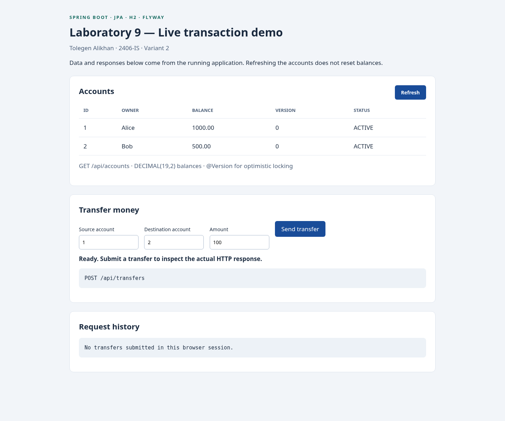
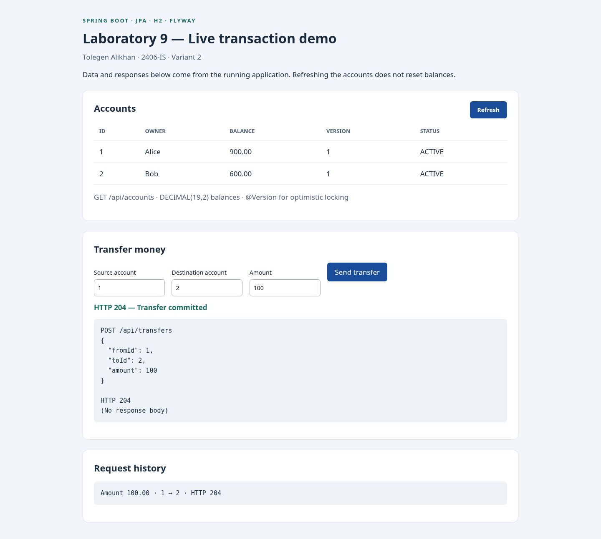
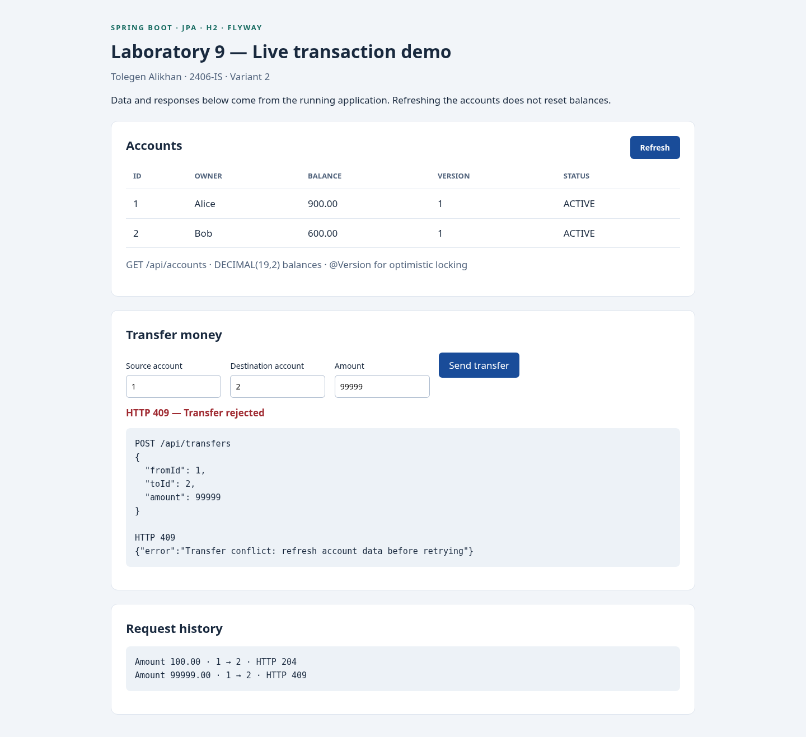
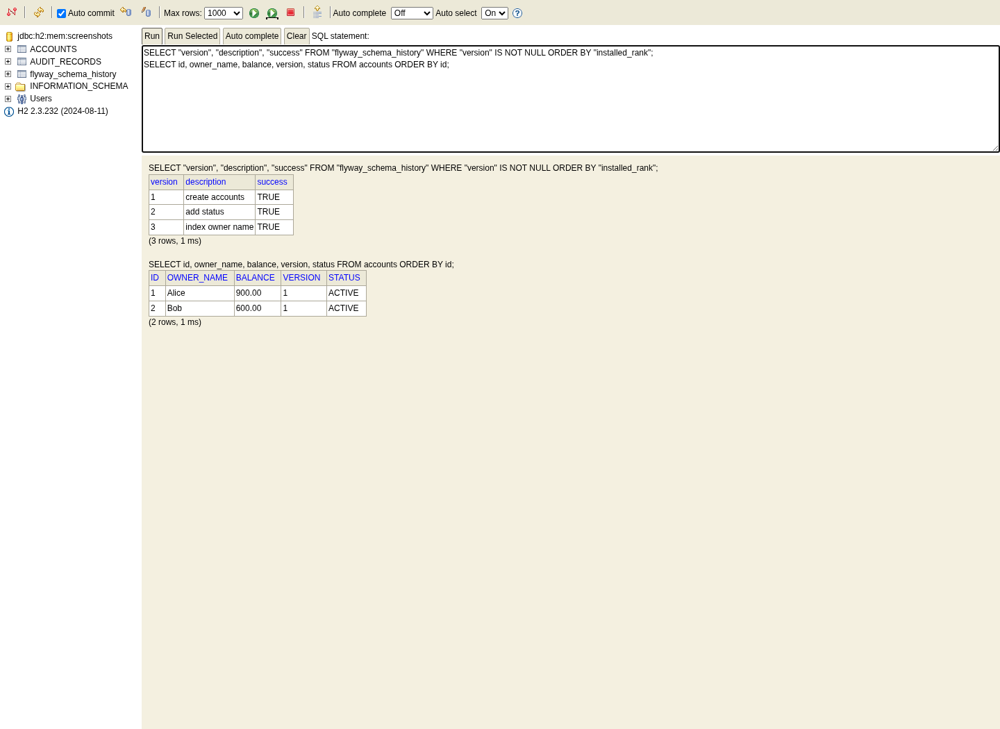
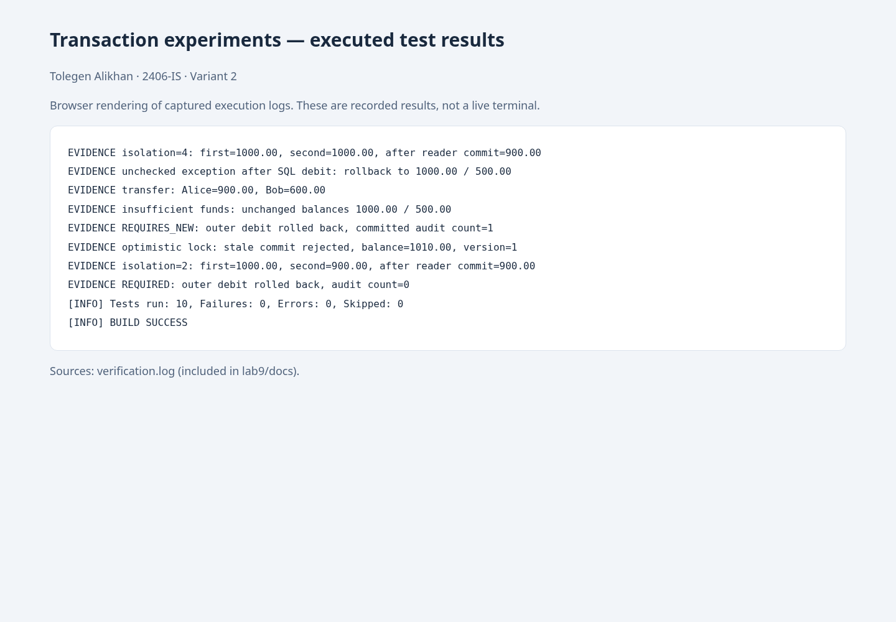
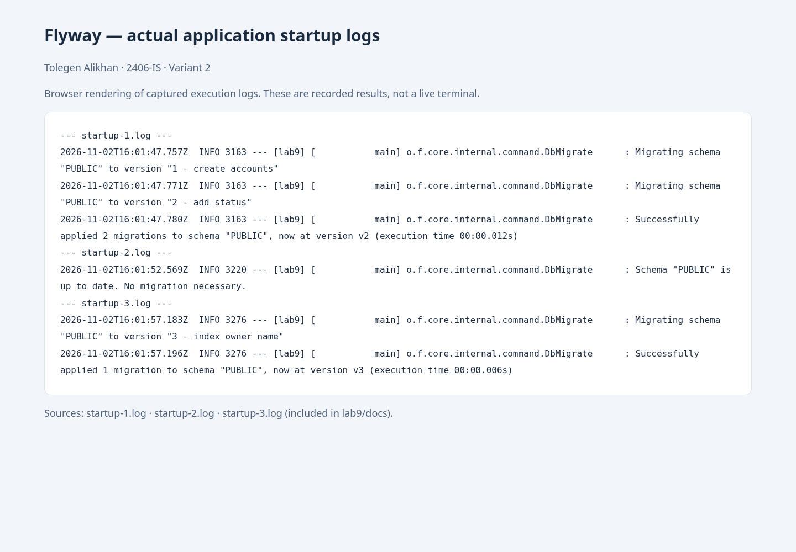

# Laboratory Work 9
## Spring Transaction Management and Database Schema Versioning

**Student:** Tolegen Alikhan  
**Group:** 2406-IS  
**Variant:** 2 (1 + 1 = 2)  
**Writing style:** Neutral technical English

## 1. Aim and scope

The aim was to implement atomic money transfers, examine transaction propagation and isolation, demonstrate optimistic locking, and verify incremental database migrations. The supplied assignment does not define separate variant-specific tasks; all mandatory tasks A–E were implemented under the variant 2 submission identifier.

## 2. Tools and project structure

The solution is a standalone project in `lab9/` within `tolegggn/spring-lab-01`. It uses Spring Boot 3.5.7, Spring Data JPA, Hibernate ORM 6.6.33.Final, H2 2.3.232, Flyway and Maven 3.9.16. The project targets Java 21 and was compiled and tested using Oracle JDK 25.0.5.0.3 with compiler release 21. The existing root project and its earlier laboratory code were preserved.

The application uses file-based H2 for restart persistence. Transaction tests use a separate in-memory H2 database, and migration tests use a temporary file database. Hibernate uses `ddl-auto=validate`, so Flyway owns schema creation and changes. No Liquibase dependency is included.

Key implementation files:

- `Account.java`: JPA account entity, decimal money operations and `@Version`.
- `AccountRepository.java`: `JpaRepository<Account, Long>`.
- `TransferService.java`: atomic transfer and controlled rollback experiment.
- `AuditService.java` and `PropagationService.java`: separate proxied services for propagation experiments.
- `AccountController.java`: account listing and transfer API with HTTP error handling.
- `TransactionTests.java` and `MigrationTests.java`: executable observations and assertions.
- `scripts/smoke.py`: real HTTP requests and application restart checks.

## 3. Schema versioning

V1 creates `accounts` with `id`, `owner_name`, `balance` and `version`, then inserts Alice with 1000.00 and Bob with 500.00. V2 adds `status`, defaulting to ACTIVE, and creates the audit table required by task B. V3 adds `idx_accounts_owner_name`.

The account entity maps every account column. The money field uses `BigDecimal` and DECIMAL(19,2). Amounts must be positive and contain at most two fractional digits. Transfers also require distinct, existing account IDs.

The migration test first targets version 2 on an empty file database: two migrations are applied. A new Flyway instance against the same database applies zero migrations. Removing the target limit applies only V3. Assertions verify three successful versioned entries in `flyway_schema_history`, the new index and both ACTIVE account rows. The HTTP smoke script separately starts and stops the actual Spring Boot application three times against one temporary file database, confirming the same sequence and persistent account balances.

## 4. Task A: Declarative transactions and rollback

The public transfer method is annotated with `@Transactional`. Both account entities are loaded inside one transaction, the source is debited, and the destination is credited. Managed entities are persisted by JPA dirty checking at commit. The boundary is at the business service, so the complete transfer either commits or rolls back.

The controlled failure method flushes the debit to the database before throwing an unchecked exception. This verifies database rollback after SQL has actually been executed, rather than merely discarding an unflushed Java object change. The failure method is used by tests and is not exposed through the REST API.

| Experiment | Observed result |
| --- | --- |
| Transfer 100.00 from Alice to Bob | Alice 900.00; Bob 600.00 |
| Attempt to transfer 1001.00 from initial Alice balance | Exception; Alice 1000.00; Bob 500.00 |
| Throw unchecked exception after flushed debit | Exception; Alice 1000.00; Bob 500.00 |
| Zero, negative, fractional-cent amount, same account or missing destination | Rejected; original balances preserved |

Spring normally rolls back on `RuntimeException` and `Error`. A checked exception does not trigger rollback by default, so an exception escaping after the debit could commit that debit. Adding `@Transactional(rollbackFor = Exception.class)` or a specific checked exception type changes this rule. This checked-exception behavior is explained from Spring's transaction contract; it was not a separate executed experiment in this submission.

## 5. Task B: Propagation

The outer transaction debits Alice by 10.00 and flushes that change. It then calls an audit method on another Spring-managed service and throws an unchecked exception after the audit method returns. Separate service objects ensure the inner call crosses a Spring proxy; self-invocation would not activate a different propagation setting.

| Inner propagation | Alice after outer failure | Audit records remaining |
| --- | --- | --- |
| REQUIRED | 1000.00 | 0 |
| REQUIRES_NEW | 1000.00 | 1 |

REQUIRED joins the existing transaction, so both debit and audit are rolled back together. REQUIRES_NEW suspends the outer transaction and commits an independent transaction on another connection. Its audit record remains after the outer rollback. The inner transaction only writes the separate audit table; it does not attempt to lock the account row held by the outer transaction.

For the optional discussion: SUPPORTS can participate when a transaction exists without requiring one; MANDATORY enforces an existing transaction; NOT_SUPPORTED suspends transaction processing; NEVER rejects calls made within a transaction. NESTED uses savepoints when supported by the selected transaction manager and database, and should not be assumed available for ordinary JPA transactions.

## 6. Task C: Isolation and independent transactions

The isolation experiment uses two independent physical database transactions. The reader starts and reads 1000.00. A REQUIRES_NEW writer commits 900.00 while the reader transaction is suspended. The original reader then reads again before completing. JDBC queries are used intentionally so Hibernate's first-level cache cannot mask the database's actual behavior.

| H2 isolation level | First read | Second read in same transaction | Read after reader completes |
| --- | --- | --- | --- |
| READ_COMMITTED | 1000.00 | 900.00 | 900.00 |
| REPEATABLE_READ | 1000.00 | 1000.00 | 900.00 |

On H2 2.3.232, READ_COMMITTED allowed the non-repeatable read, whereas REPEATABLE_READ retained the reader's snapshot. Both levels prevent dirty reads. At the SQL standard level, REPEATABLE_READ additionally prevents non-repeatable reads, but phantom reads may remain possible. Actual snapshot and locking behavior varies between databases. These tests examine repeated reads of one row; they do not claim to test phantom reads, write skew or every concurrency anomaly, and the observations must not be generalized directly to PostgreSQL, MySQL or Oracle.

## 7. Task D: Optimistic locking

Two independent EntityManagers begin transactions and load Alice at version 0. The first copy is credited by 10.00 and committed. The stored balance becomes 1010.00 and the version becomes 1. The second, stale copy is credited by 20.00 and attempts to commit using version 0.

The stale commit throws `RollbackException` with an `OptimisticLockException` cause. The final stored balance remains 1010.00 and version 1. JPA includes the old version in the update predicate and checks the affected-row count. A stale version matches no row, preventing the second copy from silently overwriting the committed update.

A safe response is to report a conflict and refresh current data. The REST controller maps Spring-translated optimistic-lock failures to HTTP 409. A money transfer should not be retried blindly: an automatic retry requires a clear policy, a fresh transaction and, where duplicate delivery is possible, an idempotency mechanism. The laboratory does not implement automatic retries or production payment guarantees.

## 8. Verification evidence

The Maven verification run completed with **10 tests, 0 failures, 0 errors and 0 skipped tests**, followed by BUILD SUCCESS. Nine tests cover transaction behavior and one covers schema migration lifecycle. Real application requests additionally verified HTTP 204 for a successful transfer, 409 for insufficient funds, 400 for a negative amount and 404 for a missing destination. The balances remained unchanged after rejected operations.

Captured evidence is provided as logs, as permitted by the assignment:

- `verification.log`: build output, test counts and EVIDENCE lines for transfer, rollback, propagation, isolation, optimistic locking and migrations.
- `http-smoke.log`: HTTP assertions and persistence checks across restarts.
- `startup-1.log`: initial application startup applying V1 and V2.
- `startup-2.log`: restart with no migration necessary.
- `startup-3.log`: upgrade applying only V3.

The logs and the browser screenshots in Appendix A are observations from this implementation. Screenshots of recorded log excerpts are labelled separately from live application and SQL-console captures. Mockito emitted a warning about dynamic agent loading on Java 25; the current tests nevertheless completed successfully.

## 9. Answers to the report questions

**1. What does @Transactional do, and where should transaction boundaries normally be placed?**
It supplies transaction metadata interpreted by Spring's transaction interceptor: begin or join a transaction, commit on successful completion and roll back according to configured exception rules. Boundaries normally surround complete business operations in the service layer. Calls must pass through the managed proxy in this configuration.

**2. What is the difference between REQUIRED and REQUIRES_NEW?**
REQUIRED joins the caller's transaction or starts one if absent. REQUIRES_NEW suspends an existing transaction and starts an independent one with its own commit or rollback outcome. It requires another available connection while the outer transaction remains active.

**3. Which anomalies are prevented by READ_COMMITTED and REPEATABLE_READ? Does behavior vary by database?**
READ_COMMITTED prevents dirty reads but permits non-repeatable reads. REPEATABLE_READ also prevents non-repeatable reads; phantom behavior and other guarantees depend on the database implementation. The H2 experiment observed a changed second read only at READ_COMMITTED. It did not test all possible anomalies.

**4. How does @Version detect concurrent updates?**
The entity's loaded version is included in its UPDATE condition. A successful change increments the stored version. An update based on an older version affects zero rows, which JPA reports as an optimistic-lock conflict. Thus, stale state cannot silently overwrite a newer commit.

**5. Why should migrations be version-controlled and immutable after deployment?**
Version control makes schema changes reviewable and reproducible alongside application code. Flyway records versions and checksums. Editing an applied migration can cause checksum validation failure and inconsistent environments. A new migration should express the next change; previously applied migrations should remain unchanged.

**6. When would Flyway be chosen over Liquibase, or Liquibase over Flyway?**
Flyway is suitable when a team prefers ordered SQL migrations and direct control over database-specific statements. Liquibase is useful when structured changesets, contexts, preconditions and declared rollback operations are desirable. Both require disciplined review and compatibility testing. Flyway was selected here because a short SQL migration sequence makes the schema lifecycle easy to inspect.

## 10. Conclusion

An atomic transfer service and repeatable transaction experiments were implemented. A successful transfer preserved the total balance, while insufficient funds and a flushed partial debit left both balances unchanged after failure. The propagation experiment showed that REQUIRED audit writes roll back with the outer transaction, whereas REQUIRES_NEW audit writes survive. H2 READ_COMMITTED observed a newly committed balance on the second read; H2 REPEATABLE_READ retained the original value. Optimistic locking rejected a stale update, preserving the first committed result. Flyway applied V1/V2, skipped them on restart and applied V3 incrementally. The results demonstrate that transaction boundaries, database isolation, version checks and immutable migrations address distinct parts of data consistency.

## Appendix A. Browser screenshots

The figures show actual Chromium page captures. Page content is captured without the desktop tab bar. Figures 1–4 show live application or database results; Figures 5–6 show browser-rendered recorded logs.

### Figure 1. Initial account state

The running application returns Alice 1000.00 and Bob 500.00, each at version 0.

### Figure 2. Successful transfer in the browser

An actual POST transfers 100.00. HTTP 204 is returned; balances become 900.00 and 600.00, with versions incremented to 1.

### Figure 3. Insufficient funds in the browser

A request for 99999.00 returns HTTP 409. The displayed balances remain 900.00 and 600.00. The flushed-debit rollback is a separate test in Figure 5.

### Figure 4. Applied migrations in H2 Console

The real SQL console shows V1, V2 and V3 with success TRUE, plus the current account balances and versions.

### Figure 5. Executed transaction experiments

Browser rendering of recorded verification.log excerpts: rollback after a flushed debit, REQUIRED versus REQUIRES_NEW, isolation, rejected stale commit and 10 passing tests. This is recorded log evidence, not a live terminal.

### Figure 6. Migration lifecycle across real restarts

Browser rendering of original startup logs: V1/V2 are applied initially, no migrations are applied on the second startup, and only V3 is applied on the third.
